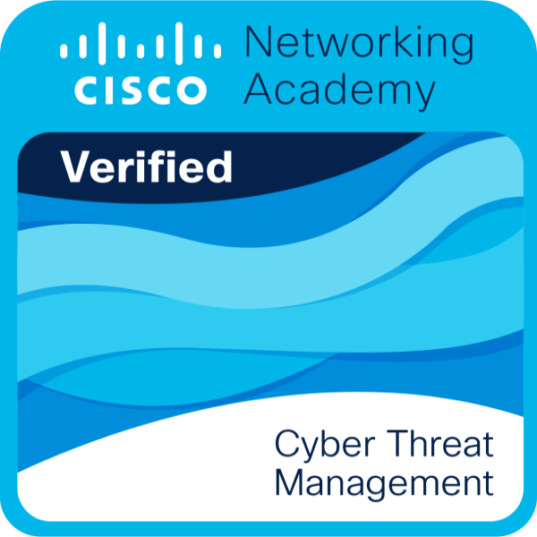
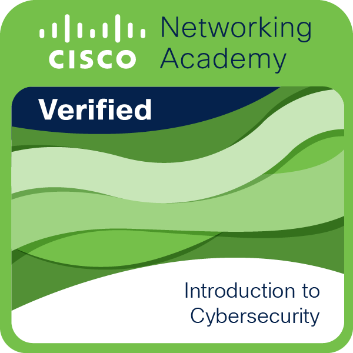
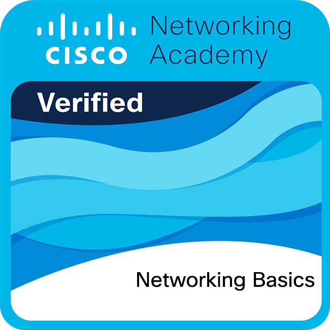

# 📄 Henrique Triches Iurkiv — Curriculum Vitae

<div align="center">

  <h1>Henrique Triches Iurkiv</h1>
  <p><strong>Desenvolvedor de Software | Graduando em Ciência da Computação (UTFPR)</strong></p>

  <!-- Badges de Acesso Rápido -->
  <p>
    <a href="https://thevingance.github.io/CurriculumVitae/" target="_blank">
      
    </a>
    <a href="curriculo.pdf" target="_blank">
      
    </a>
  </p>

  <!-- Badges de Tecnologias -->
  <p>
    
    
    
    
    
    
    
    
    
    
    
    
  </p>

  <p>
    📍 Medianeira - PR &nbsp;|&nbsp; 
    ✉️ <a href="mailto:htriches@hotmail.com">htriches@hotmail.com</a> &nbsp;|&nbsp; 
    📱 <a href="tel:+5545999434345">(45) 99943-4345</a> &nbsp;|&nbsp; 
    🐙 <a href="https://github.com/thevingance">github.com/thevingance</a>
  </p>

</div>

---

## 🎯 Sobre Mim

Desenvolvedor de Software com sólida base teórica e prática em engenharia de software, modelagem de dados e arquitetura de sistemas. Atualmente atuo na **Frimesa Cooperativa Central** com desenvolvimento e otimização de rotinas em bancos de dados Oracle de alta volumetria (PL/SQL). 

Paralelamente, curso **Bacharelado em Ciência da Computação na UTFPR**, com histórico em projetos de extensão industrial (telemetria em tempo real), arquitetura limpa em aplicações corporativas e pesquisa acadêmica de ponta em **Segurança de Inteligência Artificial** (análise empírica de vulnerabilidades contra ataques de *prompt injection* em 9 LLMs).

---

## 🛠️ Stack Tecnológica & Competências

| Área | Tecnologias & Habilidades |
| :--- | :--- |
| **Banco de Dados & Back-end** | Oracle PL/SQL & APEX (Packages, Procedures, Triggers, Views, ORDS), SQL Avançado, PostgreSQL & pgvector, Redis, MySQL |
| **Linguagens & Frameworks** | Python, FastAPI, Node.js, TypeScript, Java (POO), C#, JavaScript |
| **Front-end** | React, HTML5, CSS3 Moderno, Design Responsivo |
| **Engenharia & Arquitetura** | Clean Architecture, Domain-Driven Design (DDD), APIs RESTful, Reverse Proxy |
| **Segurança & Inteligência Artificial** | AI Firewall (LLM Gateway), LLM Engineering, RAG & Agents, Pesquisa em Segurança de LLMs, Detecção de Prompt Injection, OWASP Top 10 for LLMs, Threat Management & Vulnerability Assessment (Cisco), Ethical Hacking, Cibersegurança |
| **Sistemas & Ferramentas** | Docker & Docker Compose, Git, GitHub, Versionamento de Código, Telemetria & Automação Industrial, Redes de Computadores, Cisco IOS & Ativos de Rede |

---

## 💼 Experiência Profissional

### 🔹 Frimesa Cooperativa Central
**Desenvolvedor PL/SQL** | *Período: 2026 – Presente (Atual)*
- Desenvolvimento, otimização e manutenção de rotinas de banco de dados Oracle corporativo de missão crítica.
- Implementação de packages, procedures, funções e triggers com alta performance.
- Análise e criação de consultas complexas, automação de regras de negócio e suporte a sistemas integrados de alta demanda.

### 🔹 BIT – Empresa Júnior de Computação (Unioeste)
**Desenvolvedor de Software** | *Período: 2019 – 2020 (400 horas)*
- Desenvolvimento de projetos e soluções de software sob tutoria acadêmica (Prof. Me. Luiz Antonio Rodrigues e Prof. Me. Ivonei Freitas da Silva).
- Levantamento de requisitos com clientes reais, implementação de rotinas de negócio e versionamento em equipe com Git.

---

## 🔬 Projetos & Pesquisa Acadêmica

- **[PromptSentinel – AI Firewall & LLM Security Gateway](https://github.com/TheVingance/prompt-sentinel)** *(Projeto Pessoal / Portfólio • 2026 – Presente)*  
  Gateway reverso de segurança e firewall de alta performance para inferência em LLMs (compatível com a API da OpenAI). Pipeline assíncrono em Python e FastAPI mitigando vulnerabilidades do OWASP Top 10 for LLMs: detecção de *prompt injection* e *jailbreaks* via análise semântica e busca vetorial com PostgreSQL e `pgvector`, mascaramento de dados sensíveis (PII/DLP), rate limiting distribuído com Redis e containerização completa com Docker Compose.
- **[TCC: Segurança em Inteligência Artificial](https://github.com/TheVingance/TCC-PromptInjection)** *(Pesquisa Acadêmica • UTFPR • 2026)*  
  Framework experimental desenvolvido em Python e FastAPI para avaliação empírica de vulnerabilidade contra ataques de *prompt injection* testado em 9 modelos de linguagem (LLMs).
- **Sistema de Monitoramento Térmico Industrial – NINFA** *(Projeto de Extensão UTFPR)*  
  Desenvolvimento de solução para aquisição, processamento e telemetria de dados térmicos em tempo real para controle operacional em ambientes industriais.
- **Projeto Celilac – Segurança Alimentar** *(Projeto de Extensão UTFPR)*  
  Plataforma web de auxílio a celíacos para rastreamento de alérgenos e mitigação de contaminação cruzada. Back-end construído em Node.js e TypeScript aplicando Clean Architecture e DDD.

---

## 🎓 Formação Acadêmica

- **Bacharelado em Ciência da Computação**  
  *Universidade Tecnológica Federal do Paraná (UTFPR)* — 2022 a 2026 *(Em fase de conclusão)*

---

## 🛡️ Credenciais Digitais & Badges Verificadas (Cisco Networking Academy)

<table>
  <tr>
    <td align="center" width="50%">
      <a href="assets/certificates/cisco-cyber-threat-management.pdf" target="_blank">
        <br/>
        <strong>Cyber Threat Management</strong>
      </a><br/>
      <sub>Cisco Networking Academy • Emitido em 14 de Outubro de 2026</sub><br/>
      <small>🔒 Avaliação de Vulnerabilidades, Planos de Gestão de Riscos, Resposta a Incidentes & Forense</small><br/>
      <a href="assets/certificates/cisco-cyber-threat-management.pdf">📄 <i>Visualizar Certificado Oficial (PDF)</i></a>
    </td>
    <td align="center" width="50%">
      <a href="assets/certificates/cisco-introduction-to-cybersecurity.pdf" target="_blank">
        <br/>
        <strong>Introduction to Cybersecurity</strong>
      </a><br/>
      <sub>Cisco Networking Academy • Emitido em 10 de Outubro de 2026</sub><br/>
      <small>🛡️ Fundamentos de Cibersegurança, Vetores de Ataques, Defesa Cibernética & Operações Seguras</small><br/>
      <a href="assets/certificates/cisco-introduction-to-cybersecurity.pdf">📄 <i>Visualizar Certificado Oficial (PDF)</i></a>
    </td>
  </tr>
  <tr>
    <td align="center" width="50%">
      <a href="assets/certificates/cisco-networking-basics.pdf" target="_blank">
        <br/>
        <strong>Networking Basics</strong>
      </a><br/>
      <sub>Cisco Networking Academy • Emitido em 14 de Outubro de 2026</sub><br/>
      <small>🌐 Arquitetura e Protocolos de Rede, Ethernet, IPv4/IPv6, Roteamento & Wi-Fi Seguro</small><br/>
      <a href="assets/certificates/cisco-networking-basics.pdf">📄 <i>Visualizar Certificado Oficial (PDF)</i></a>
    </td>
    <td align="center" width="50%">
      <a href="assets/certificates/cisco-networking-devices-and-initial-configuration.pdf" target="_blank">
        <br/>
        <strong>Networking Devices & Initial Configuration</strong>
      </a><br/>
      <sub>Cisco Networking Academy • Emitido em 16 de Outubro de 2026</sub><br/>
      <small>⚙️ Configuração via Cisco IOS, Subnetting IPv4, Comutação Ethernet & Serviços de Rede</small><br/>
      <a href="assets/certificates/cisco-networking-devices-and-initial-configuration.pdf">📄 <i>Visualizar Certificado Oficial (PDF)</i></a>
    </td>
  </tr>
</table>

---

## 📜 Cursos & Certificações

- **Cyber Threat Management** — Cisco Networking Academy • Credencial Verificada Oficial (Out/2026) [📄 [Certificado PDF](assets/certificates/cisco-cyber-threat-management.pdf)]
- **Introduction to Cybersecurity** — Cisco Networking Academy • Credencial Verificada Oficial (Out/2026) [📄 [Certificado PDF](assets/certificates/cisco-introduction-to-cybersecurity.pdf)]
- **Networking Basics** — Cisco Networking Academy • Credencial Verificada Oficial (Out/2026) [📄 [Certificado PDF](assets/certificates/cisco-networking-basics.pdf)]
- **Networking Devices and Basic Configuration** — Cisco Networking Academy • Credencial Verificada Oficial (Out/2026) [📄 [Certificado PDF](assets/certificates/cisco-networking-devices-and-initial-configuration.pdf)]
- **AI Engineer Core Track: LLM Engineering, RAG, QLoRA, Agents** — Udemy (Ligency & Ed Donner) • 33,5h
- **AI Engineer Production Track: Deploy LLMs & Agents at Scale** — Udemy (Ligency & Ed Donner) • 18,5h
- **Banco de Dados: Oracle PL/SQL** — IFRS (Inst. Federal do Rio Grande do Sul) • 20h
- **Workshop Oracle APEX – Sales Hub & ORDS** — Frimesa Cooperativa Central • 8h
- **Básico – Formação em Cibersegurança** — Hackers do Bem / SENAI SP • 64h
- **Nivelamento – Formação em Cibersegurança** — Hackers do Bem / SENAI SP • 80h
- **Google SecOps Foundation** — Arki1 (Paulo Breviglieri) • 2h
- **JavaScript: Fundamentos para Desenvolvimento Web Interativo** — IFRS (Inst. Federal do RS) • 40h
- **Python 3 do Básico ao Avançado com Projetos** — Udemy • 141,5h
- **Java COMPLETO: Programação Orientada a Objetos + Projetos** — Udemy (Prof. Nelio Alves) • 54h
- **Arquitetura de Redes** — Udemy (Prof. Gabriel Torres) • 26,5h
- **Fundamentos de Ethical Hacking Prático** — Udemy • 24,5h
- **Introdução à Computação Quântica** — UTFPR (CACOMP-MD / DACOM-MD) • 8h

---

## 💻 Como Rodar Este Projeto Localmente

O currículo online é construído com HTML5 semântico e CSS3 puro, sem necessidade de build steps:

1. **Clone o repositório:**
   ```bash
   git clone https://github.com/TheVingance/CurriculumVitae.git
   cd CurriculumVitae
   ```

2. **Abra o arquivo no seu navegador favorito:**
   - Dê um duplo clique em `index.html` ou abra via Live Server no VS Code.

> [!NOTE]
> **Acesso via GitHub Pages:**  
> A página está publicada em: **[thevingance.github.io/CurriculumVitae](https://thevingance.github.io/CurriculumVitae/)**  
> *(Atenção: O GitHub Pages diferencia maiúsculas e minúsculas no nome do repositório).*

---

<div align="center">
  <small>© Henrique Triches Iurkiv • Desenvolvido com foco em performance, acessibilidade e design moderno</small>
</div>